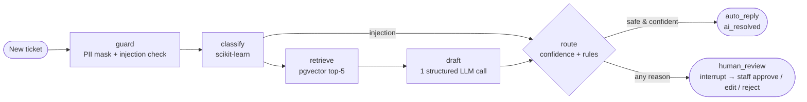

# 🎧 SupportGenie: AI Customer-Support Copilot

> Answers routine customer tickets instantly from company docs (**RAG**), sends risky or uncertain ones to a human agent with a ready draft (**LangGraph human-in-the-loop**), and shows managers what customers are struggling with (**ML + K-means**).

   

**Live demo:** _coming soon_ · **Demo video:** _coming soon_

Demo company: **ShopNest**, a fictional Indian e-commerce store (orders, refunds, payments, delivery...).

---

## 📊 Results (demo data)

| Metric | Value |
|---|---|
| Ticket classifier (TF-IDF + Logistic Regression) | **99.66%** test accuracy, **0.997** macro-F1 · 20/20 on hand-written English + Hinglish messages |
| Tickets resolved by AI without a human | **51%** (37 demo tickets) |
| Average response time | AI **~13.5 s** vs human agent ~4.2 min (**~19x faster**) |
| Customer satisfaction (👍 / all ratings) | **87%** |
| LLM calls per ticket | **1** |
| Automated tests | **73** pytest tests + **~88** live end-to-end HTTP checks |

---

## 💡 What it does

1. **Guard:** masks PII (card, phone, email, UPI, Aadhaar-style IDs, OTP/CVV values) and flags prompt-injection attempts *before* any text reaches the LLM.
2. **Classify:** a scikit-learn model predicts the ticket category in milliseconds.
3. **Retrieve:** RAG finds the most relevant sections of the company's help docs (pgvector, cosine similarity).
4. **Draft:** **one** structured LLM call returns the reply plus `answer_found`, `self_confidence`, `sentiment`, `language`, `requires_human_action`.
5. **Route:** confidence = 0.5·LLM + 0.3·retrieval + 0.2·classifier, plus hard safety rules.
   - Confident, routine, calm customer → **instant AI reply** with cited sources.
   - Otherwise → **paused** (LangGraph `interrupt`) until a staff member approves / edits / rejects the draft.
6. **Learn what's missing:** low-similarity questions are logged as **knowledge gaps**; recent tickets are clustered with **K-means** into trending issues.

Always sent to a human: suspected prompt injection, answer not in the docs, frustrated customer, account actions, **money problems** ("charged twice", "paise kat gaye", "refund not received"), low confidence (stricter 0.80 threshold for payment/refund tickets), and any 👎 on an AI answer.



---

## ✨ Features

**Customer:** sign up / log in · raise a ticket and get an answer with sources in seconds · English, Hindi or Hinglish (reply comes back in the same language) · track status · 👍 / 👎 feedback (👎 escalates to a human) · change password.

**Staff:** review queue sorted by priority, with the reasons the AI escalated · review screen with masked message, category, confidence, sources and an editable AI draft · approve / edit / reject (resumes the paused graph) · knowledge-base upload (PDF / Markdown / TXT, indexed in the background) with a test-search box · analytics dashboard (auto-resolution rate, response times, satisfaction, tickets per day / category, **K-means trending issues**, **knowledge gaps**).

**MCP server:** 6 read-only tools so a staff member can ask an MCP client (e.g. Claude Desktop) things like *"show today's urgent tickets"* or *"what does our refund policy say?"*.

**Production basics:** JWT + bcrypt, role-based access (`customer` / `staff`), Pydantic validation, rate limiting (login 10/min, signup 5/min, tickets 20/min per IP, spoof-proof behind proxies), Alembic migrations, request IDs + structured logs, LLM retry + Groq → Gemini fallback, a ticket is never lost (any failure → human review), cold-start screen for free hosting.

---

## 🛠️ Tech stack (100% free tier)

| Layer | Technology |
|---|---|
| Frontend | React 18, Vite 6, React Router, Axios, Tailwind CSS 4, Recharts, lucide-react |
| Backend | FastAPI, Pydantic v2, SQLAlchemy 2.0, Alembic |
| Auth | JWT (PyJWT) + bcrypt, role-based dependencies |
| Database | PostgreSQL on **Neon** + **pgvector** (HNSW cosine index), also stores LangGraph checkpoints |
| ML | NumPy, Pandas, scikit-learn (TF-IDF + Logistic Regression vs Linear SVM vs Complement NB), joblib, K-means + silhouette |
| Embeddings | **fastembed** `BAAI/bge-small-en-v1.5` (384-d, ONNX, runs on CPU, no API key) |
| LLM | **Groq** `openai/gpt-oss-120b` (primary) → **Gemini 2.5 Flash** (fallback) |
| GenAI | **LangChain** (prompts, structured output, retry/fallbacks, text splitters, custom `Embeddings` + `BaseRetriever`), **LangGraph** (state graph, conditional edges, `interrupt` / `Command(resume)`, Postgres checkpointer) |
| Tools protocol | **MCP** Python SDK 2.x (`MCPServer`, stdio) |
| Deployment (planned) | Render (API) · Vercel (web) · Neon (DB) |

---

## 📁 Project structure

```
├── backend/
│   ├── app/
│   │   ├── main.py            # app factory, CORS, request-ID logging, model preload
│   │   ├── core/              # config (.env), db, security (JWT, roles), rate_limit
│   │   ├── models/            # users, tickets, kb_documents, kb_chunks (vector), feedback, knowledge_gaps
│   │   ├── schemas/           # Pydantic request / response models
│   │   ├── api/               # auth, tickets, review, kb, analytics, health routers
│   │   ├── services/          # guard.py, llm.py, tickets.py, analytics.py, ml/, rag/
│   │   └── agent/             # LangGraph: state, policy (all thresholds), prompts, nodes, graph
│   ├── alembic/               # database migrations
│   ├── ml_models/             # classifier.joblib (+ metrics)
│   ├── scripts/               # create_staff, seed_kb, seed_demo_data, e2e_check, ...
│   ├── tests/                 # 73 pytest tests (no keys / internet needed)
│   └── .env.example
├── frontend/                  # React app (customer + staff UI)
│   └── .env.example
├── ml/
│   ├── data/                  # dataset goes here (not in repo, download steps in ml/data/README.md)
│   ├── notebooks/01_eda.ipynb # EDA + cleaning
│   ├── reports/               # metrics.json, confusion_matrix.png
│   └── train.py               # reproducible training (compares 3 models)
├── kb_docs/                   # 11 ShopNest help-center docs (the RAG knowledge base)
├── mcp_server/                # server.py (6 tools), smoke_test.py, .env.example
├── docs/                      # agent graph, e2e report
└── start-dev.ps1              # one command: backend + frontend + browser (Windows)
```

---

## 🚀 Run it locally

**Needs:** Python 3.12, Node.js 20+, a free [Neon](https://neon.tech) Postgres database, a free [Groq](https://console.groq.com) API key (Gemini key from [Google AI Studio](https://aistudio.google.com) optional, used as fallback).

```powershell
# 1. Python environment (project root)
python -m venv .venv
.venv\Scripts\activate
pip install -r backend/requirements.txt -r ml/requirements.txt -r mcp_server/requirements.txt

# 2. Backend config: copy the example and fill in your own values
copy backend\.env.example backend\.env
copy frontend\.env.example frontend\.env

# 3. Database tables + knowledge base + a staff account (from backend/)
cd backend
alembic upgrade head
python -m scripts.seed_kb
python -m scripts.create_staff --name "Your Name" --email you@example.com
cd ..

# 4. Start everything (Windows): opens backend + frontend windows and the browser
.\start-dev.ps1
```

Or start them separately:

```powershell
cd backend;  uvicorn app.main:app --reload --no-proxy-headers   # http://localhost:8000/docs
cd frontend; npm install; npm run dev                            # http://localhost:5173
```

Optional:

```powershell
python ml/train.py                               # retrain the classifier (download the dataset first: ml/data/README.md)
cd backend; python -m scripts.seed_demo_data     # 37 demo tickets through the real agent (fills the dashboard)
```

### Environment variables

| File | Variable | Notes |
|---|---|---|
| `backend/.env` | `DATABASE_URL` | Neon connection string (paste as-is) |
| | `JWT_SECRET` | random, ≥ 32 chars: `python -c "import secrets; print(secrets.token_urlsafe(48))"` |
| | `GROQ_API_KEY`, `GOOGLE_API_KEY` | at least one is needed for AI replies |
| | `FRONTEND_URL` | `http://localhost:5173` locally, your Vercel URL in production |
| | `TRUSTED_PROXY_HOPS` | `0` locally, `1` on Render |
| `frontend/.env` | `VITE_API_URL` | backend URL (no secrets here, it is public) |
| MCP client config | `SUPPORTGENIE_API_URL`, `SUPPORTGENIE_EMAIL`, `SUPPORTGENIE_PASSWORD` | see `mcp_server/.env.example` and `mcp_server/README.md` |

> Real `.env` files are git-ignored. Never commit API keys.

---

## 🔌 API overview

Interactive docs at `http://localhost:8000/docs` (disabled in production).

| Area | Endpoints | Who |
|---|---|---|
| Auth | `POST /api/auth/signup` · `POST /api/auth/login` · `GET /api/auth/me` · `POST /api/auth/change-password` | public / logged in |
| Tickets | `POST /api/tickets` · `GET /api/tickets` · `GET /api/tickets/{id}` · `POST /api/tickets/{id}/feedback` | customer |
| Review | `GET /api/review/queue` · `GET /api/review/tickets` · `GET /api/review/tickets/{id}` · `POST /api/review/tickets/{id}` (approve / edit / reject) | staff |
| Knowledge base | `POST /api/kb/upload` · `GET /api/kb/documents` · `DELETE /api/kb/documents/{id}` · `GET /api/kb/search` | staff |
| Analytics | `GET /api/analytics/summary` · `GET /api/analytics/trends` · `GET /api/analytics/gaps` | staff |
| Health | `GET /health` | public |

---

## 🧪 Testing

```powershell
cd backend
python -m pytest                  # 73 tests: fake LLM + SQLite + in-memory checkpointer, no keys or internet
python -m scripts.e2e_check       # ~88 live HTTP checks against the running backend (real LLM + Neon) → docs/e2e_report.md
python ../mcp_server/smoke_test.py   # MCP server end-to-end (needs SUPPORTGENIE_EMAIL / PASSWORD set)
```

| Suite | Covers |
|---|---|
| `test_auth.py` | signup, login, JWT, roles, change password, rate limiting (incl. X-Forwarded-For spoofing) |
| `test_kb.py` | loaders, chunking, upload pipeline, failures, delete |
| `test_guard.py` | PII masking, injection detection, confidence / priority / money rules |
| `test_agent_flow.py` | every LangGraph path, PII never reaches the LLM, approve / edit / reject resume, permissions, feedback |
| `test_analytics.py` | KPIs, K-means trends, knowledge gaps |

---

## 🗺️ Roadmap

- [x] EDA + classifier (3 models compared, real-world check)
- [x] Backend: auth, roles, tickets, migrations, rate limiting
- [x] RAG: upload → chunk → embed → pgvector search
- [x] LangGraph agent with human-in-the-loop (Postgres checkpointer)
- [x] Analytics: KPIs, K-means trends, knowledge gaps
- [x] MCP server (6 read-only tools)
- [x] React frontend (customer + staff)
- [x] 73 automated tests + live end-to-end check
- [ ] Deploy (Render + Vercel + Neon)
- [ ] Screenshots + demo video
- [ ] Stretch: streaming replies, RAG evaluation set, self-learning loop (approved replies → KB)

---

## 📜 Data & credits

- Ticket classifier trained on the **Bitext Customer Support dataset** © Bitext Innovations ([Hugging Face](https://huggingface.co/datasets/bitext/Bitext-customer-support-llm-chatbot-training-dataset), CDLA-Sharing-1.0). The dataset is not included here; see [`ml/data/README.md`](ml/data/README.md) to download it.
- `kb_docs/` are fictional help-center pages written for the demo company ShopNest.

## 👤 Author

Built as the final capstone of an internship training program (React · FastAPI · ML · GenAI).
# Support_Genie

