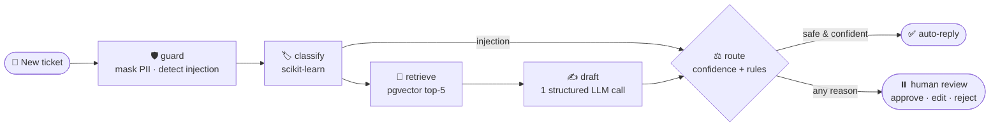
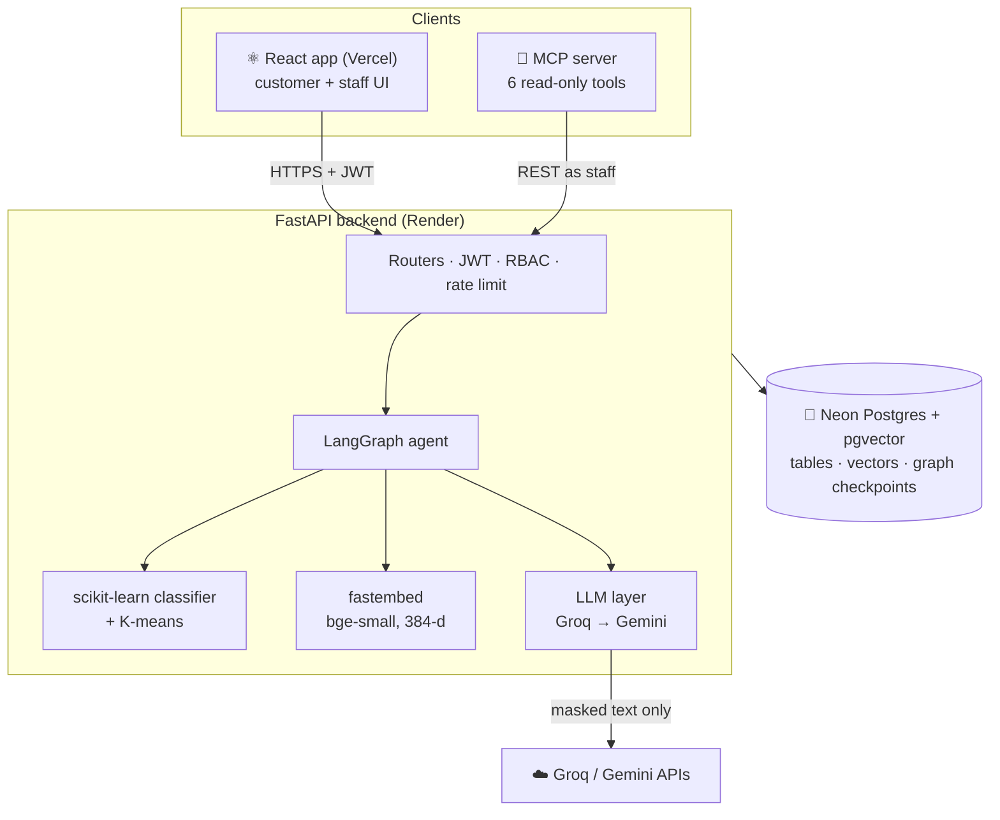

<div align="center">

# 🧞 SupportGenie

### AI customer-support copilot that answers routine tickets instantly and hands risky ones to a human

**RAG over company docs** · **LangGraph human-in-the-loop** · **ML ticket classification** · **K-means trend analytics** · **MCP server**


[Features](#-features) · [How it works](#-how-it-works) · [Architecture](#-architecture) · [Tech stack](#-tech-stack) · [Run locally](#-run-locally) · [Testing](#-testing)

</div>

---

## 📌 The problem

Support teams get hundreds of tickets a day, and most are the same questions: *"Where is my refund?"*, *"How do I change my address?"*. Agents waste time typing identical answers, customers wait hours, and genuinely urgent issues get stuck behind easy ones.

**Fully automatic chatbots** are fast but make confident mistakes. **Fully manual support** is safe but slow.

## 💡 The solution

SupportGenie sits between customers and the support team and **decides, ticket by ticket, whether the AI can be trusted to answer**:

- ✅ **Routine, well-documented, calm** → answered by AI in ~13 seconds, with cited sources
- ⏸️ **Risky, uncertain, angry, or about money** → paused with a ready AI draft for a human to approve, edit or reject
- 📈 **Everything** → feeds a dashboard of trending issues and *knowledge gaps* (questions the docs couldn't answer)

The demo company is **ShopNest**, a fictional Indian e-commerce store.

---

## 📊 Results

<div align="center">

| 🎯 Classifier accuracy | 🤖 Auto-resolved by AI | ⚡ Response time | 😊 Satisfaction | 💸 LLM calls / ticket |
|:---:|:---:|:---:|:---:|:---:|
| **99.7%** | **51%** | **~13.5 s** vs ~4.2 min | **87%** | **1** |
| macro-F1 0.997 · 20/20 on real-style Hinglish | of 37 demo tickets | **~19x faster** than an agent | 👍 / all ratings | free-tier friendly |

</div>

---

## ✨ Features

<table>
<tr>
<td width="50%" valign="top">

### 👤 Customer
- Sign up / log in (JWT)
- Raise a ticket → AI answer with **sources** in seconds
- Write in **English, Hindi or Hinglish**, reply comes back in the same language
- Track status: *AI answered* · *Waiting for agent* · *Agent answered*
- 👍 / 👎 feedback (👎 sends it to a human)
- Change password

</td>
<td width="50%" valign="top">

### 🧑‍💼 Staff
- **Review queue** sorted by priority, with the *reasons* the AI escalated
- **Review screen**: masked message, category, confidence, sources, editable AI draft
- **Approve / Edit / Reject** (resumes the paused LangGraph run)
- **Knowledge base**: upload PDF / Markdown, indexed in the background, test search box
- **Analytics**: auto-resolution rate, response times, satisfaction, **K-means trending issues**, **knowledge gaps**

</td>
</tr>
<tr>
<td valign="top">

### 🛡️ Safety
- **PII masking** before the LLM (card, phone, email, UPI, Aadhaar-style IDs, OTP/CVV)
- **Prompt-injection detection**: flagged tickets skip the LLM entirely
- **Money problems always go to a human** ("charged twice", "paise kat gaye", "refund not received")
- Stricter confidence threshold for payment / refund tickets

</td>
<td valign="top">

### ⚙️ Production basics
- Role-based access (`customer` / `staff`), bcrypt, Pydantic validation
- Rate limiting, spoof-proof behind proxies
- Groq → Gemini **fallback** with retries
- A ticket is **never lost**: any failure → human review
- Alembic migrations, request IDs, structured logs
- Cold-start screen for free hosting

</td>
</tr>
</table>

**🔌 MCP server:** 6 read-only tools let a staff member ask an MCP client like Claude Desktop *"show today's urgent tickets"* or *"what does our refund policy say?"*.

---

## 🧠 How it works

Every ticket goes through one **LangGraph** agent:



| Step | What happens |
|---|---|
| **1. Guard** | Personal data is replaced with tags like `[CARD]`. Injection attempts ("ignore previous instructions…") are flagged. |
| **2. Classify** | TF-IDF + Logistic Regression predicts the category (ORDER, REFUND, PAYMENT…) in milliseconds, for free. |
| **3. Retrieve** | The question is embedded locally (fastembed) and the 5 closest help-doc chunks are found with pgvector cosine search. |
| **4. Draft** | **One** LLM call returns a structured object: `reply`, `answer_found`, `self_confidence`, `sentiment`, `language`, `requires_human_action`. |
| **5. Route** | Combines three signals and checks safety rules. Any rule hit → human review with the reasons attached. |

**Confidence score**

```
confidence = 0.5 × LLM self-confidence
           + 0.3 × retrieval strength      (top similarity, rescaled from 0.55–0.85 to 0–1)
           + 0.2 × classifier probability
```

Auto-reply only if confidence ≥ **0.70** (≥ **0.80** for payment / refund tickets) **and** none of these is true: injection suspected · answer not in docs · frustrated customer · account action needed · money problem.

**Human-in-the-loop:** a paused ticket is saved by LangGraph's **Postgres checkpointer**, so it survives server restarts. When staff decide, the graph resumes exactly where it stopped (`interrupt()` → `Command(resume=…)`).

---

## 🏗️ Architecture



---

## 🛠️ Tech stack

| Layer | Technology |
|---|---|
| **Frontend** | React 18 · Vite 6 · React Router · Axios · Tailwind CSS 4 · Recharts |
| **Backend** | FastAPI · Pydantic v2 · SQLAlchemy 2.0 · Alembic |
| **Auth** | JWT (PyJWT) · bcrypt · role-based dependencies |
| **Database** | PostgreSQL on Neon · **pgvector** (HNSW cosine index) |
| **ML** | NumPy · Pandas · scikit-learn (3 models compared) · joblib · K-means + silhouette |
| **Embeddings** | fastembed `BAAI/bge-small-en-v1.5` (ONNX, CPU, no API key) |
| **LLM** | Groq `openai/gpt-oss-120b` → Gemini 2.5 Flash fallback |
| **GenAI** | **LangChain** (prompts, structured output, retry / fallbacks, text splitters, custom retriever) · **LangGraph** (state graph, conditional edges, interrupt / resume, Postgres checkpointer) |
| **Tools protocol** | MCP Python SDK 2.x |
| **Hosting** | Render · Vercel · Neon (all free tier) |

<details>
<summary><b>Why these choices?</b></summary>

- **ML classifier instead of asking the LLM** → milliseconds, free, deterministic and measurable. The LLM is used only where language generation is needed.
- **One LLM call per ticket** → fits free-tier rate limits; sentiment, language and confidence come in the same structured response.
- **pgvector instead of a separate vector DB** → one database for app data, vectors and agent checkpoints; nothing stored on the (ephemeral) server disk.
- **fastembed (ONNX) instead of PyTorch** → fits in Render's 512 MB free tier.
- **Three confidence signals** → retrieval similarity alone was unreliable in testing (an out-of-scope question scored 0.62, a valid one 0.67).

</details>

---

## 📁 Project structure

```
supportgenie/
├── backend/
│   ├── app/
│   │   ├── main.py          # app factory, CORS, request logging, model preload
│   │   ├── core/            # config, database, JWT + roles, rate limiter
│   │   ├── models/          # SQLAlchemy tables (incl. pgvector chunks)
│   │   ├── schemas/         # Pydantic request / response models
│   │   ├── api/             # auth · tickets · review · kb · analytics · health
│   │   ├── services/        # guard (PII), llm (fallback), rag/, ml/, analytics
│   │   └── agent/           # LangGraph: state · policy · prompts · nodes · graph
│   ├── alembic/             # database migrations
│   ├── ml_models/           # trained classifier (joblib)
│   ├── scripts/             # create_staff · seed_kb · seed_demo_data · e2e_check
│   └── tests/               # 73 pytest tests
├── frontend/                # React app
├── ml/                      # EDA notebook · train.py · reports (dataset: see ml/data/README.md)
├── kb_docs/                 # 11 ShopNest help-center docs (the RAG knowledge base)
├── mcp_server/              # MCP server + smoke test
├── docs/                    # agent graph · e2e report
└── start-dev.ps1            # start backend + frontend with one command (Windows)
```

---

## 🚀 Run locally

**You need:** Python 3.12 · Node.js 20+ · a free [Neon](https://neon.tech) database · a free [Groq](https://console.groq.com) API key ([Gemini](https://aistudio.google.com) key optional, used as fallback)

```powershell
# 1. Install
python -m venv .venv
.venv\Scripts\activate
pip install -r backend/requirements.txt -r ml/requirements.txt -r mcp_server/requirements.txt

# 2. Configure (then open the two .env files and fill in your own values)
copy backend\.env.example backend\.env
copy frontend\.env.example frontend\.env

# 3. Set up the database, knowledge base and a staff account
cd backend
alembic upgrade head
python -m scripts.seed_kb
python -m scripts.create_staff --name "Your Name" --email you@example.com
cd ..

# 4. Start backend + frontend + browser (Windows)
.\start-dev.ps1
```

Open **http://localhost:5173** · API docs at **http://localhost:8000/docs**

<details>
<summary><b>Start the servers manually</b></summary>

```powershell
cd backend;  uvicorn app.main:app --reload --no-proxy-headers
cd frontend; npm install; npm run dev
```
</details>

<details>
<summary><b>Optional: demo data and retraining</b></summary>

```powershell
cd backend; python -m scripts.seed_demo_data    # 37 demo tickets through the real agent (fills the dashboard)
python ml/train.py                              # retrain the classifier (download the dataset first: ml/data/README.md)
```
</details>

<details>
<summary><b>Environment variables</b></summary>

| File | Variable | Notes |
|---|---|---|
| `backend/.env` | `DATABASE_URL` | Neon connection string |
| | `JWT_SECRET` | ≥ 32 random chars: `python -c "import secrets; print(secrets.token_urlsafe(48))"` |
| | `GROQ_API_KEY` / `GOOGLE_API_KEY` | at least one needed for AI replies |
| | `FRONTEND_URL` | `http://localhost:5173` locally, Vercel URL in production |
| | `TRUSTED_PROXY_HOPS` | `0` locally, `1` on Render |
| `frontend/.env` | `VITE_API_URL` | backend URL (public, never put secrets here) |
| MCP client | `SUPPORTGENIE_API_URL` / `_EMAIL` / `_PASSWORD` | see `mcp_server/.env.example` |

Real `.env` files are git-ignored.
</details>

---

## 🔌 API overview

| Area | Endpoints | Access |
|---|---|---|
| **Auth** | `POST /api/auth/signup` · `POST /api/auth/login` · `GET /api/auth/me` · `POST /api/auth/change-password` | public / logged in |
| **Tickets** | `POST /api/tickets` · `GET /api/tickets` · `GET /api/tickets/{id}` · `POST /api/tickets/{id}/feedback` | customer |
| **Review** | `GET /api/review/queue` · `GET /api/review/tickets` · `GET /api/review/tickets/{id}` · `POST /api/review/tickets/{id}` | staff |
| **Knowledge base** | `POST /api/kb/upload` · `GET /api/kb/documents` · `DELETE /api/kb/documents/{id}` · `GET /api/kb/search` | staff |
| **Analytics** | `GET /api/analytics/summary` · `GET /api/analytics/trends` · `GET /api/analytics/gaps` | staff |
| **Health** | `GET /health` | public |

---

## 🧪 Testing

```powershell
cd backend
python -m pytest                     # 73 tests: fake LLM, SQLite, no keys or internet needed
python -m scripts.e2e_check          # ~88 live HTTP checks against the running backend
```

| Suite | Covers |
|---|---|
| `test_auth.py` | signup, login, JWT, roles, change password, rate limiting (incl. IP spoofing) |
| `test_kb.py` | file loaders, chunking, upload pipeline, failures, delete |
| `test_guard.py` | PII masking, injection detection, confidence / priority / money rules |
| `test_agent_flow.py` | every agent path, PII never reaches the LLM, approve / edit / reject, permissions, feedback |
| `test_analytics.py` | KPIs, K-means trends, knowledge gaps |

---

## 🗺️ Roadmap

- [x] EDA + classifier (3 models compared, real-world check)
- [x] Backend: auth, roles, tickets, migrations, rate limiting
- [x] RAG pipeline with pgvector
- [x] LangGraph agent with human-in-the-loop
- [x] Analytics: K-means trends, knowledge gaps
- [x] MCP server
- [x] React frontend
- [x] 73 automated tests + live end-to-end check
- [ ] Deploy (Render + Vercel + Neon)
- [ ] Screenshots + demo video
- [ ] Streaming replies · RAG evaluation set · self-learning loop (approved replies → KB)

---

## 📜 Credits

- Classifier trained on the [Bitext Customer Support dataset](https://huggingface.co/datasets/bitext/Bitext-customer-support-llm-chatbot-training-dataset) © Bitext Innovations (CDLA-Sharing-1.0). Not included in this repo; see [`ml/data/README.md`](ml/data/README.md).
- `kb_docs/` are fictional help pages written for the demo company ShopNest.

<div align="center">

**Built as the final capstone of an internship training program** · React · FastAPI · ML · GenAI

</div>
